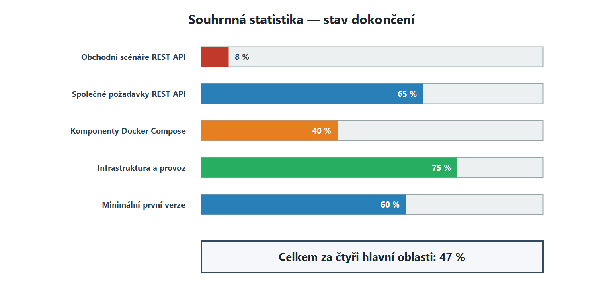
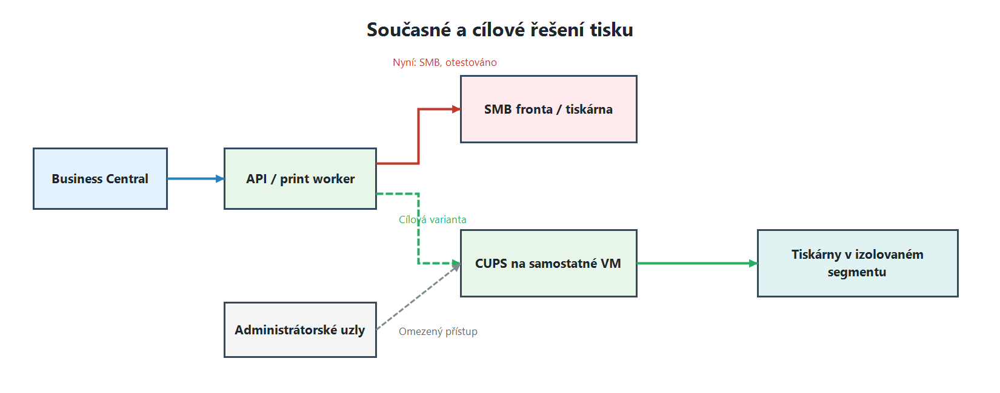

# API (cloudready) — aktuální stav (BC Gateway)

Datum: 05.11.2026–06.11.2026

## Souhrnná statistika

| Oblast | Hotovo |
|---|---|
| Obchodní scénáře pro delegování do REST API | **≈ 8 %** |
| Společné požadavky na REST API | **65 %** |
| Komponenty stacku Docker Compose | **40 %** |
| Infrastruktura a provoz | **75 %** |
| Minimální první verze (5 služeb) | **60 %** (3 z 5) |
| **Celkem (průměr čtyř hlavních oblastí)** | **≈ 47 %** |

Stručně: platforma (fronta, databáze, outbox, API, retry/DLQ, monitoring, backup) je postavena dobře a pokrývá většinu infrastrukturních požadavků. Z obchodních scénářů reálně funguje pouze FTP/SFTP; PDF, tisk, přepravci, FinStat a SQL zatím nejsou zahájeny.

### Souhrnná statistika — stav dokončení

## 1. Obchodní scénáře (≈ 8 %)

| Scénář | Hotovo | Co je / co chybí |
|---|---|---|
| FTP/SFTP a SafeQueFile | 80 % | Je: FTP/FTPS/SFTP upload, list, download (podle názvu nebo masky), move, retry s backoff, idempotence, DLQ, ruční retry, profily v `ftp.yaml`. Chybí: pravidelný polling adresářů/front podle plánu, automatická archivace, samostatná podpora SafeQueFile. |
| Tisk na běžné tiskárně | 10 % | Tisk byl otestován pouze v režimu SMB; je k dispozici diagnostický skript `test-vprint-connection.py`. Tisk přes CUPS ani Print Agent nebyl ověřen. |
| Tisk PDF | 10 % | Je: architektura společného print jobu a varianty odeslání PDF přes CUPS nebo Print Agent. Chybí: implementovaný handler pro tisk PDF. |
| Tisk dat Base64 | 0 % | Chybí: příjem a validace Base64, dekódování obsahu do dokumentu a předání výsledku do tiskového subsystému. |
| Tisk čárových kódů na tiskárnách Zebra | 0 % | Chybí: generování příkazů ZPL, profily tiskáren Zebra a odesílání printer-ready dat do zařízení. |
| Slučování PDF | 0 % | — |
| PDF Template Management | 0 % | — |
| EDI, SKF, Škoda Auto, Eračun | 15 % | Je: přenos EDI souborů přes FTP profily `FTP-GMORS-DESADV` / `FTP-GMORS-ORDRSP`. Chybí: AS2, podpis/šifrování, validace XSD, transformace formátů. |
| SQL management a skladové zásoby | 0 % | — |
| FinStat | 0 % | — |
| Přepravci (GLS/DPD/GEIS/TNT/FedEx) | 0 % | — |
| NCH | 0 % | Bude možné znovu využít FTP přenos. |
| Obrázky na čtečkách | 0 % | — |
| WebService Management (gateway) | 0 % | — |

> **Samostatná infrastrukturní otázka tisku.** Je nutné posoudit přechod z otestovaného režimu SMB na CUPS provozovaný na samostatné VM. Přístup k této VM a tiskárnám musí být izolován na síťové úrovni a povolen pouze komponentám API/worker a administrátorským uzlům.

> **Důležité omezení SMB.** Současný režim SMB umožňuje potvrdit předání úlohy do sdílené fronty, neposkytuje však úplné end-to-end sledování jejího provedení. Úspěšné odeslání nezaručuje, že tiskárna úlohu přijala, dokončila tisk a fyzicky vytiskla dokument.

## 2. Společné požadavky na REST API (65 %)

| Požadavek | Hotovo | Komentář |
|---|---|---|
| Idempotence | 100 % | Unikátní index `(type, idempotency_key)`, handlery jsou idempotentní podle `task_id`. |
| Asynchronní model + status endpoint | 100 % | Úlohy přes frontu, `GET /api/v1/tasks/{id}`, seznam s cursor pagination, WebSocket notifikace. |
| Verzovaný kontrakt, chybové kódy, health | 100 % | `/api/v1/...`, jednotný formát chyb (`AUTH_REQUIRED`, `TASK_NOT_FOUND` …), `/health` a `/health/ready`, OpenAPI `/docs`. |
| Limity, timeout, retry s backoff, correlation ID, logy | 60 % | Je: retry 15 s → 1 → 5 → 15 min, DLQ, `request_id` v chybách, timeouty outboxu, metriky v logu. Nepopsáno: limity velikosti požadavku, průběžné correlation ID, pravidla logování bez osobních údajů. |
| HTTPS a OAuth 2.0 / krátkodobé tokeny | 30 % | Je: `X-API-Key`, tajné údaje pouze v `.env`. Chybí: HTTPS (API naslouchá přes HTTP na `127.0.0.1:8000`), OAuth 2.0 / managed identity. |
| AL client codeunit, setup table/page, permissions, integrační testy v BC | 0 % | — |

## 3. Komponenty stacku (40 %)

| Služba | Cíl | Hotovo | Komentář |
|---|---|---|---|
| api | FastAPI, Uvicorn, Pydantic | 100 % | Implementováno včetně Swagger UI. |
| rabbitmq | Spolehlivá fronta | 100 % | Durable topologie, `tasks.direct`, DLX, priority, TTL 7 dní. |
| postgres | SQLAlchemy, Alembic | 100 % | Modely v `bc_gateway_core`, migrace přes `migrator`. |
| redis (volitelně) | Cache tokenů, rate limiting, zámky | 50 % | Nasazen, ale používá se pro Pub/Sub WebSocketu, ne pro cache/rate limiting. |
| worker-integrations | HTTPX, lxml, Paramiko | 30 % | Je FTP/FTPS/SFTP worker (vlastní consumer, ne Celery). Chybí přepravci, FinStat, EDI, REST/SOAP. |
| observability (volitelně) | OpenTelemetry, Prometheus/Grafana | 20 % | Jsou metriky-čítače v logu relay a workeru, `make health`. Chybí OTel/Prometheus. |
| reverse-proxy (Nginx) | Nginx, TLS | 0 % | API je publikováno přímo na loopback. |
| worker-documents | Typst, pikepdf | 0 % | Nezahájeno. Pokryje rovnou tři scénáře s vysokou vhodností: slučování PDF, šablony, čárové kódy/štítky. |
| scheduler | Celery Beat | 0 % | Pravidelný polling FTP a čištění chybí. |
| minio (volitelně) | S3 úložiště | 0 % | Soubory se ukládají do `/app/data/documents`. |

## 4. Infrastruktura a provoz (75 %)

| Požadavek | Hotovo | Komentář |
|---|---|---|
| Samostatný Linux server, Docker Engine + Compose | 100 % | Stack běží na samostatném SSH serveru. |
| Backup databáze | 100 % | `make backup-postgres` s kontrolou `pg_restore --list` a politikou uchovávání záloh. |
| Healthchecks | 100 % | `make health`: PostgreSQL, Redis, RabbitMQ, readiness API, DLQ, exit kódy pro monitoring. |
| Rotace logů | 100 % | Logging driver `local` s limity, konfigurace logrotate. |
| Pojmenované volumes | 75 % | Jsou pro PostgreSQL, RabbitMQ, Redis a dokumenty. Chybí `typst_templates` (Typst zatím není nasazen). |
| Navenek pouze HTTPS port | 50 % | AMQP a Redis nejsou publikovány, PostgreSQL a API jen na loopback. Webové rozhraní RabbitMQ je ale publikováno (podle README je nutné ho před produkcí odstranit) a HTTPS port zatím neexistuje. |
| Důvěryhodný TLS certifikát | 0 % | Závisí na reverse-proxy (Nginx). |

## Souhrnná tabulka

| Oblast | Prvek | Hotovo |
|---|---|---|
| Integrace | FTP / FTPS / SFTP | 80 % |
| Zpracování | tisk na běžné tiskárně (otestováno pouze SMB) | 10 % |
| Zpracování | tisk PDF | 10 % |
| Zpracování | tisk dat Base64 | 0 % |
| Zpracování | tisk čárových kódů na tiskárnách Zebra | 0 % |
| Zpracování | worker-documents (Typst / pikepdf) | 0 % |
| Vstup | reverse-proxy (Nginx) | 0 % |
| Vstup | HTTPS / OAuth 2.0 | 30 % |
| Jádro | FastAPI | 100 % |
| Jádro | PostgreSQL (tasks, outbox) | 100 % |
| Jádro | RabbitMQ (q.ftp, DLX, q.dead_letter) | 100 % |
| Jádro | Redis (Pub/Sub stavů) | 50 % |
| Zpracování | worker-integrations | 30 % |
| Zpracování | scheduler | 0 % |
| Integrace | EDI (SKF, Škoda Auto, Eračun) | 15 % |
| Integrace | přepravci / FinStat / NCH / SQL | 0 % |
| Úložiště | volumes | 75 % |
| Úložiště | MinIO | 0 % |
| Provoz | observability | 20 % |
| Provoz | backup | 100 % |
| Provoz | healthchecks | 100 % |
| Provoz | rotace logů | 100 % |
| Provoz | TLS certifikát | 0 % |
| **Celkem** | scénáře ≈ 8 % · požadavky 65 % · komponenty 40 % · infrastruktura 75 % | **≈ 47 %** |

## Seznam zkratek

### Platforma a vývoj

| Zkratka | Význam |
|---|---|
| AL | Application Language — jazyk pro vývoj rozšíření Microsoft Dynamics 365 Business Central. |
| API | Application Programming Interface — aplikační programové rozhraní. |
| BC | Microsoft Dynamics 365 Business Central. |
| DB | Database — databáze. |
| ID | Identifier — jedinečný identifikátor. |
| MVP | Minimum Viable Product — minimální životaschopný produkt. |
| OTel | OpenTelemetry — sada standardů a nástrojů pro telemetrii. |
| REST | Representational State Transfer — architektonický styl pro tvorbu webových API. |
| VM | Virtual Machine — virtuální stroj. |

### Síťové protokoly a zabezpečení

| Zkratka | Význam |
|---|---|
| AS2 | Applicability Statement 2 — protokol pro zabezpečenou výměnu obchodních dokumentů přes internet. |
| FTP | File Transfer Protocol — protokol pro přenos souborů. |
| FTPS | FTP over TLS — protokol FTP zabezpečený pomocí TLS. |
| HTTPS | Hypertext Transfer Protocol Secure — zabezpečený protokol HTTP. |
| OAuth 2.0 | Open Authorization 2.0 — standard delegované autorizace. |
| SFTP | SSH File Transfer Protocol — zabezpečený protokol pro přenos souborů přes SSH. |
| SMB | Server Message Block — protokol pro sdílený přístup k souborům a tiskárnám. |
| SOAP | Simple Object Access Protocol — protokol pro výměnu strukturovaných zpráv webových služeb. |
| TLS | Transport Layer Security — protokol pro zabezpečení síťového spojení. |

### Fronty a úložiště

| Zkratka | Význam |
|---|---|
| AMQP | Advanced Message Queuing Protocol — protokol pro výměnu zpráv. |
| DLQ | Dead Letter Queue — fronta zpráv, které se nepodařilo zpracovat. |
| DLX | Dead Letter Exchange — RabbitMQ exchange pro přesměrování nezpracovaných zpráv. |
| S3 | Simple Storage Service — rozhraní objektového úložiště kompatibilní s S3. |
| TTL | Time to Live — doba platnosti zprávy nebo dat. |

### Dokumenty, data a tisk

| Zkratka | Význam |
|---|---|
| Base64 | Způsob reprezentace binárních dat jako textového řetězce. |
| CUPS | Common UNIX Printing System — tiskový systém pro operační systémy typu Unix. |
| PDF | Portable Document Format — formát elektronických dokumentů. |
| SQL | Structured Query Language — jazyk strukturovaných dotazů pro databáze. |
| XML | Extensible Markup Language — rozšiřitelný značkovací jazyk. |
| XSD | XML Schema Definition — jazyk pro popis struktury a pravidel XML dokumentu. |
| ZPL | Zebra Programming Language — příkazový jazyk pro tiskárny Zebra. |

### Doménové systémy a integrace

| Zkratka | Význam |
|---|---|
| EDI | Electronic Data Interchange — elektronická výměna dat a obchodních dokumentů. |
| NCH | Interní označení integrace skladových a celních operací; úplný význam není ve zdrojových materiálech uveden. |
| SKF | Svenska Kullagerfabriken — společnost SKF; v dokumentu označuje EDI integraci s tímto obchodním partnerem. |
