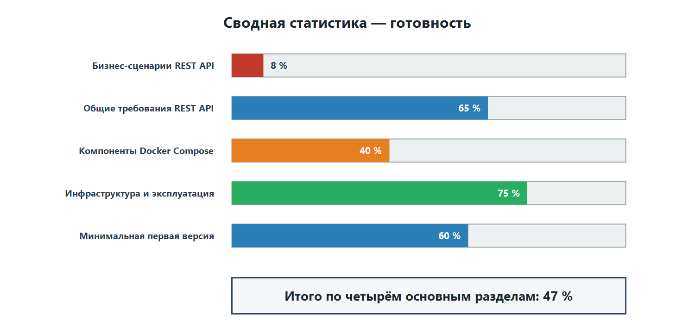
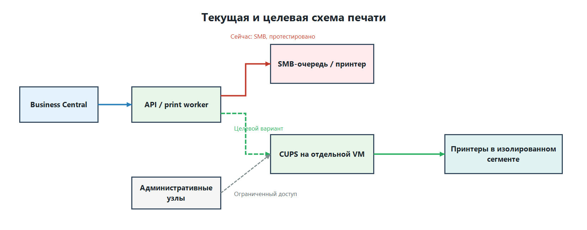

# API (cloudready) — текущее состояние (BC Gateway)

Дата: 05.11.2026 - 06.11.2026

## Сводная статистика

| Раздел | Готовность |
|---|---|
| Бизнес-сценарии для делегирования в REST API | **≈ 8 %** |
| Общие требования к REST API | **65 %** |
| Компоненты стека Docker Compose | **40 %** |
| Инфраструктура и эксплуатация | **75 %** |
| Минимальная первая версия (5 сервисов) | **60 %** (3 из 5) |
| **Итого (среднее по четырём основным разделам)** | **≈ 47 %** |

Коротко: платформа (очередь, БД, outbox, API, retry/DLQ, мониторинг, backup) построена хорошо и закрывает большую часть инфраструктурных требований. Из бизнес-сценариев реально работает только FTP/SFTP; PDF, печать, перевозчики, FinStat и SQL ещё не начаты.

### Сводная статистика — готовность

## 1. Бизнес-сценарии (≈ 8 %)

| Сценарий | Готовность | Что есть / чего нет |
|---|---|---|
| FTP/SFTP и SafeQueFile | 80 % | Есть: FTP/FTPS/SFTP upload, list, download (по имени или маске), move, retry с backoff, идемпотентность, DLQ, ручной retry, профили в `ftp.yaml`. Нет: периодического polling каталогов/очередей по расписанию, автоматической архивации, отдельной поддержки SafeQueFile. |
| Печать на обычный принтер | 10 % | Печать оттестирована только в режиме SMB; есть диагностический скрипт `test-vprint-connection.py`. Печать через CUPS и Print Agent не проверена. |
| Печать PDF | 10 % | Есть: архитектура общего print job и варианты отправки PDF через CUPS или Print Agent. Нет: реализованного обработчика печати PDF. |
| Печать данных Base64 | 0 % | Нет: приёма и проверки Base64, декодирования содержимого в документ и передачи результата в подсистему печати. |
| Печать штрихкодов на принтерах Zebra | 0 % | Нет: генерации команд ZPL, профилей принтеров Zebra и отправки printer-ready данных на устройство. |
| Объединение PDF | 0 % | — |
| PDF Template Management | 0 % | — |
| EDI, SKF, Škoda Auto, Eračun | 15 % | Есть: транспорт EDI-файлов через FTP-профили `FTP-GMORS-DESADV` / `FTP-GMORS-ORDRSP`. Нет: AS2, подписи/шифрования, валидации XSD, трансформации форматов. |
| SQL management и складские остатки | 0 % | — |
| FinStat | 0 % | — |
| Перевозчики (GLS/DPD/GEIS/TNT/FedEx) | 0 % | — |
| NCH | 0 % | Можно будет переиспользовать FTP-транспорт. |
| Изображения на терминалах сбора данных | 0 % | — |
| WebService Management (gateway) | 0 % | — |

> **Отдельный инфраструктурный вопрос по печати.** Нужно проработать переход с протестированного SMB-режима на CUPS, развёрнутый на отдельной VM. Доступ к этой VM и принтерам должен быть изолирован на сетевом уровне и разрешён только API/worker-компонентам и административным узлам.

## 2. Общие требования к REST API (65 %)

| Требование | Готовность | Комментарий |
|---|---|---|
| Идемпотентность | 100 % | Уникальный индекс `(type, idempotency_key)`, обработчики идемпотентны по `task_id`. |
| Асинхронная модель + status endpoint | 100 % | Задачи через очередь, `GET /api/v1/tasks/{id}`, список с cursor pagination, WebSocket-уведомления. |
| Версионированный контракт, коды ошибок, health | 100 % | `/api/v1/...`, единый формат ошибок (`AUTH_REQUIRED`, `TASK_NOT_FOUND` …), `/health` и `/health/ready`, OpenAPI `/docs`. |
| Лимиты, timeout, retry с backoff, correlation ID, логи | 60 % | Есть: retry 15 с → 1 → 5 → 15 мин, DLQ, `request_id` в ошибках, таймауты outbox, метрики в логах. Не описаны: лимиты размера запроса, сквозной correlation ID, политика логов без персональных данных. |
| HTTPS и OAuth 2.0 / короткоживущие токены | 30 % | Есть: `X-API-Key`, секреты только в `.env`. Нет: HTTPS (API слушает HTTP на `127.0.0.1:8000`), OAuth 2.0 / managed identity. |
| AL client codeunit, setup table/page, permissions, интеграционные тесты в BC | 0 % | — |

## 3. Компоненты стека (40 %)

| Сервис | Цель | Готовность | Комментарий |
|---|---|---|---|
| api | FastAPI, Uvicorn, Pydantic | 100 % | Реализован, включая Swagger UI. |
| rabbitmq | Надёжная очередь | 100 % | Durable-топология, `tasks.direct`, DLX, приоритеты, TTL 7 суток. |
| postgres | SQLAlchemy, Alembic | 100 % | Модели в `bc_gateway_core`, миграции через `migrator`. |
| redis (опционально) | Кэш токенов, rate limiting, блокировки | 50 % | Развёрнут, но используется для Pub/Sub WebSocket, а не для кэша/rate limiting. |
| worker-integrations | HTTPX, lxml, Paramiko | 30 % | Есть FTP/FTPS/SFTP worker (собственный consumer, не Celery). Нет перевозчиков, FinStat, EDI, REST/SOAP. |
| observability (опционально) | OpenTelemetry, Prometheus/Grafana | 20 % | Есть метрики-счётчики в логах relay и worker, `make health`. Нет OTel/Prometheus. |
| reverse-proxy (Nginx) | Nginx, TLS | 0 % | API опубликован напрямую на loopback. |
| worker-documents | Typst, pikepdf | 0 % | Не начат. Даёт сразу три сценария с высокой пригодностью: объединение PDF, шаблоны, штрихкоды/этикетки. |
| scheduler | Celery Beat | 0 % | Регулярный polling FTP и очистка отсутствуют. |
| minio (опционально) | S3-хранилище | 0 % | Файлы хранятся в `/app/data/documents`. |

## 4. Инфраструктура и эксплуатация (75 %)

| Требование | Готовность | Комментарий |
|---|---|---|
| Отдельный Linux-сервер, Docker Engine + Compose | 100 % | Стек работает на отдельном SSH-сервере. |
| Backup БД | 100 % | `make backup-postgres` с проверкой `pg_restore --list` и политикой хранения резервных копий. |
| Healthchecks | 100 % | `make health`: PostgreSQL, Redis, RabbitMQ, readiness API, DLQ, exit codes для мониторинга. |
| Ротация логов | 100 % | Logging driver `local` с лимитами, конфигурация logrotate. |
| Именованные volumes | 75 % | Есть для PostgreSQL, RabbitMQ, Redis, документов. Нет `typst_templates` (Typst ещё не внедрён). |
| Наружу только HTTPS-порт | 50 % | AMQP и Redis не публикуются, PostgreSQL и API — только loopback. Но веб-интерфейс RabbitMQ проброшен (по README его нужно убрать перед продакшеном), а HTTPS-порта пока нет. |
| Доверенный TLS-сертификат | 0 % | Зависит от reverse-proxy (Nginx). |

## Итоговая таблица

| Область | Элемент | Готовность |
|---|---|---|
| Интеграции | FTP / FTPS / SFTP | 80 % |
| Обработчики | печать на обычный принтер (протестирован только SMB) | 10 % |
| Обработчики | печать PDF | 10 % |
| Обработчики | печать данных Base64 | 0 % |
| Обработчики | печать штрихкодов на принтерах Zebra | 0 % |
| Обработчики | worker-documents (Typst / pikepdf) | 0 % |
| Вход | reverse-proxy (Nginx) | 0 % |
| Вход | HTTPS / OAuth 2.0 | 30 % |
| Ядро | FastAPI | 100 % |
| Ядро | PostgreSQL (tasks, outbox) | 100 % |
| Ядро | RabbitMQ (q.ftp, DLX, q.dead_letter) | 100 % |
| Ядро | Redis (Pub/Sub статусов) | 50 % |
| Обработчики | worker-integrations | 30 % |
| Обработчики | scheduler | 0 % |
| Интеграции | EDI (SKF, Škoda Auto, Eračun) | 15 % |
| Интеграции | перевозчики / FinStat / NCH / SQL | 0 % |
| Хранилище | volumes | 75 % |
| Хранилище | MinIO | 0 % |
| Эксплуатация | observability | 20 % |
| Эксплуатация | backup | 100 % |
| Эксплуатация | healthchecks | 100 % |
| Эксплуатация | ротация логов | 100 % |
| Эксплуатация | TLS-сертификат | 0 % |
| **Итого** | сценарии ≈ 8 % · требования 65 % · компоненты 40 % · инфраструктура 75 % | **≈ 47 %** |

## Список сокращений

### Платформа и разработка

| Сокращение | Расшифровка |
|---|---|
| AL | Application Language — язык разработки расширений Microsoft Dynamics 365 Business Central. |
| API | Application Programming Interface — программный интерфейс приложения. |
| BC | Microsoft Dynamics 365 Business Central. |
| БД | База данных. |
| ID | Identifier — уникальный идентификатор. |
| MVP | Minimum Viable Product — минимально жизнеспособный продукт. |
| OTel | OpenTelemetry — набор стандартов и инструментов телеметрии. |
| REST | Representational State Transfer — архитектурный стиль построения веб-API. |
| VM | Virtual Machine — виртуальная машина. |

### Сетевые протоколы и безопасность

| Сокращение | Расшифровка |
|---|---|
| AS2 | Applicability Statement 2 — протокол защищённого обмена бизнес-документами через интернет. |
| FTP | File Transfer Protocol — протокол передачи файлов. |
| FTPS | FTP over TLS — FTP с шифрованием TLS. |
| HTTPS | Hypertext Transfer Protocol Secure — защищённый протокол HTTP. |
| OAuth 2.0 | Open Authorization 2.0 — стандарт делегированной авторизации. |
| SFTP | SSH File Transfer Protocol — защищённый протокол передачи файлов поверх SSH. |
| SMB | Server Message Block — протокол общего доступа к файлам и принтерам. |
| SOAP | Simple Object Access Protocol — протокол обмена структурированными сообщениями веб-сервисов. |
| TLS | Transport Layer Security — протокол защиты сетевого соединения. |

### Очереди и хранение

| Сокращение | Расшифровка |
|---|---|
| AMQP | Advanced Message Queuing Protocol — протокол обмена сообщениями. |
| DLQ | Dead Letter Queue — очередь сообщений, которые не удалось обработать. |
| DLX | Dead Letter Exchange — обменник RabbitMQ для перенаправления необработанных сообщений. |
| S3 | Simple Storage Service — S3-совместимый интерфейс объектного хранения. |
| TTL | Time to Live — срок жизни сообщения или данных. |

### Документы, данные и печать

| Сокращение | Расшифровка |
|---|---|
| Base64 | Способ представления двоичных данных в виде текстовой строки. |
| CUPS | Common UNIX Printing System — система печати для Unix-подобных ОС. |
| PDF | Portable Document Format — формат электронных документов. |
| SQL | Structured Query Language — язык структурированных запросов к базам данных. |
| XML | Extensible Markup Language — расширяемый язык разметки. |
| XSD | XML Schema Definition — язык описания структуры и правил XML-документа. |
| ZPL | Zebra Programming Language — язык команд для принтеров Zebra. |

### Предметные системы и интеграции

| Сокращение | Расшифровка |
|---|---|
| EDI | Electronic Data Interchange — электронный обмен данными и бизнес-документами. |
| NCH | Внутреннее обозначение интеграции складских и таможенных операций; полная расшифровка в исходных материалах не указана. |
| SKF | Svenska Kullagerfabriken — компания SKF; в документе обозначает EDI-интеграцию с этим контрагентом. |
